# InnVa: supplier invoices into AutoCount, read by AI and checked by people

InnVa is an internal web app I built for an accounting firm in Malaysia. Staff upload supplier invoices, receipts,
payment slips and expense claims. The app reads each document with AI, matches the supplier, suggests the account for
every line, and lets a reviewer check it. It then posts the document into **AutoCount Accounting 2.2**, for many
client companies from one screen.

It has been in production since September 2026, posting into five client books.

https://github.com/user-attachments/assets/951aaf89-9b57-4348-be11-0555d63f8443

*The 3-minute demo, with voiceover, chapter by chapter: add a client book (its bridge sets itself up) · upload a month as one ZIP ·
supplier and customer recognised · accounts coded from history · post and verify · a payment linked to its invoice.*
If the player doesn't load, [download the video](docs/video/innva-demo.mp4) (MP4, 9 MB).

> **About the code and the pictures.** The source is private: it was built for a client and holds their data. Every
> picture and the video come from a copy of the app filled with **made-up companies and invoices**, with stand-ins
> for the AI service and for AutoCount. I'm happy to walk through the code in an interview.

| | |
|---|---|
| 🖱️ **[Click through the app](https://trisglenanne9.github.io/innva/)** | a 22-screen walkthrough in your browser: click the highlighted button on each screen, as in the real app |
| 📐 **[Architecture](docs/ARCHITECTURE.md)** | where each part runs, how the two servers talk, the posting contract, the AI pipeline, security, delivery |
| 📘 **[Operations guide](docs/GUIDE.md)** | how the firm uses it day to day, screen by screen, plus admin tasks and troubleshooting |
| 🔌 **[The AutoCount bridge](https://github.com/trisglenanne9/autocount-bridge)** | the C# service on the AutoCount server: how it turns AutoCount's desktop SDK into a safe, outbound-only job worker |

---

## The problem

Bookkeepers were keying supplier invoices into AutoCount by hand, across many client companies, each with its own
chart of accounts and supplier list. The work is repetitive, and the costly mistakes are quiet ones: an invoice keyed
twice, a line coded to the wrong account, a credit note posted as an invoice.

InnVa reads the documents, does the matching and coding, and stops those mistakes before they reach the books.
A person still approves everything.

## What it does

- **Upload anything.** PDFs, phone photos, ZIPs or a whole folder. In *Mixed batch* mode the app works out what each
  document is: a supplier bill, a staff claim, a payment slip, a cash book entry or a journal.
- **AI reads it.** OCR, then a language model pulls out the supplier, dates, numbers and line items. One PDF can hold
  several invoices. PDFs that already contain text skip OCR and go to a smaller model, about 80% cheaper.
- **Matches the supplier** against AutoCount's creditor list, allowing for typos, with guards against near-misses.
  A supplier AutoCount doesn't know yet can be created as part of posting the bill.
- **Codes every line** from a saved rule first, then from how this supplier was posted before, then by AI, and says
  which one it used. The reviewer makes the final call.
- **Blocks bad posts.** Lines that don't add up, lines with no account, likely duplicates and misplaced credit notes
  all stop at the Post button, with the reason shown.
- **Posts, then checks.** Each posted document is read back out of AutoCount and compared field by field with what
  was sent. That is the *Verified* mark.
- **Links payments to invoices.** A payment voucher or bank slip is matched to the invoices it pays by payee, amount
  and the invoice numbers printed on it. After a person confirms the knock-off, it's posted to AutoCount as a payment.
- **New client books set themselves up.** Adding a book can build its AutoCount bridge automatically: a set-up service
  on the AutoCount server claims it, builds it, enrols it with a single-use code and reports each step to the app.
- **Stays in step with AutoCount.** AutoCount's own change log is read every minute, so documents keyed or edited
  directly in AutoCount are known too.
- **And more:** cash book and journal drafts, bank statement checks, AutoCount's own financial reports, AI cost per document, Microsoft sign-in, per-person access to each client
  book, and a full audit log.

## Architecture in one picture

AutoCount has **no web API**. Its only interface is a .NET library that must run on the machine where AutoCount is
installed. So the system is two programs on two machines:

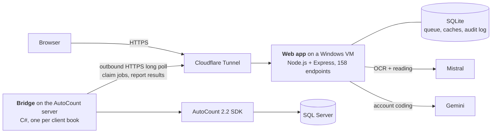

**How the two servers talk.** Only the bridge calls between them, and only **outwards**: it keeps one HTTPS request
waiting on the app (`GET /pending-sync?wait=25`). When a reviewer clicks Post, the app answers that waiting request
with the job straight away. The bridge posts it through the AutoCount SDK and reports back (`POST /sync-result`).
Nothing can connect into the AutoCount server, and the app server is only reachable through the tunnel.

**Why a retry can't post twice.** Every job carries an idempotency key. The bridge writes each result to a local
history **before** reporting it, so if anything dies halfway, a retry replays the stored result instead of posting a
second invoice.

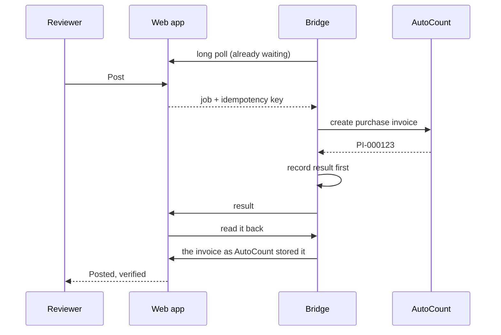

The full picture, including the deployment diagram, the job types, onboarding a new client book and the security
model, is in **[docs/ARCHITECTURE.md](docs/ARCHITECTURE.md)**.

## Engineering highlights

- **Safe retries over an unreliable link:** a queue with idempotency keys, dependent jobs (create the supplier, then
  post the invoice) and stalled-job handling that never double-posts.
- **Fast without inbound connections:** a long poll makes a click on Post reach AutoCount in milliseconds.
- **Trust, then verify:** every post is read back and compared, with comparison rules that avoid false alarms.
- **One verdict:** whether a document can be posted is decided in one place on the server and shown as it is.
- **AI where it helps, people where it matters:** the books' own history and rules come before the model, and a person
  approves every post.
- **Merging is deploying:** 205 test files on every merge request, then a deploy that health-checks itself and rolls
  back automatically.

## Screens

**One invoice opened:** the document on the left, what was read on the right.

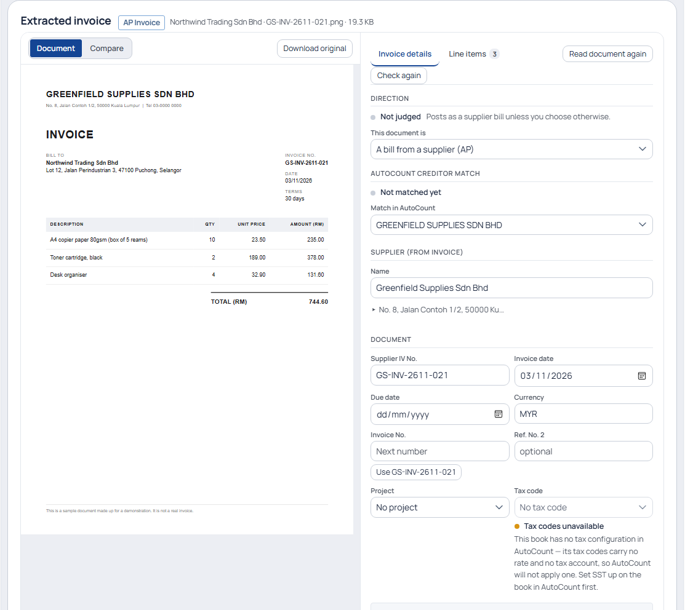

**Line items, coded from this supplier's history** (dark mode):

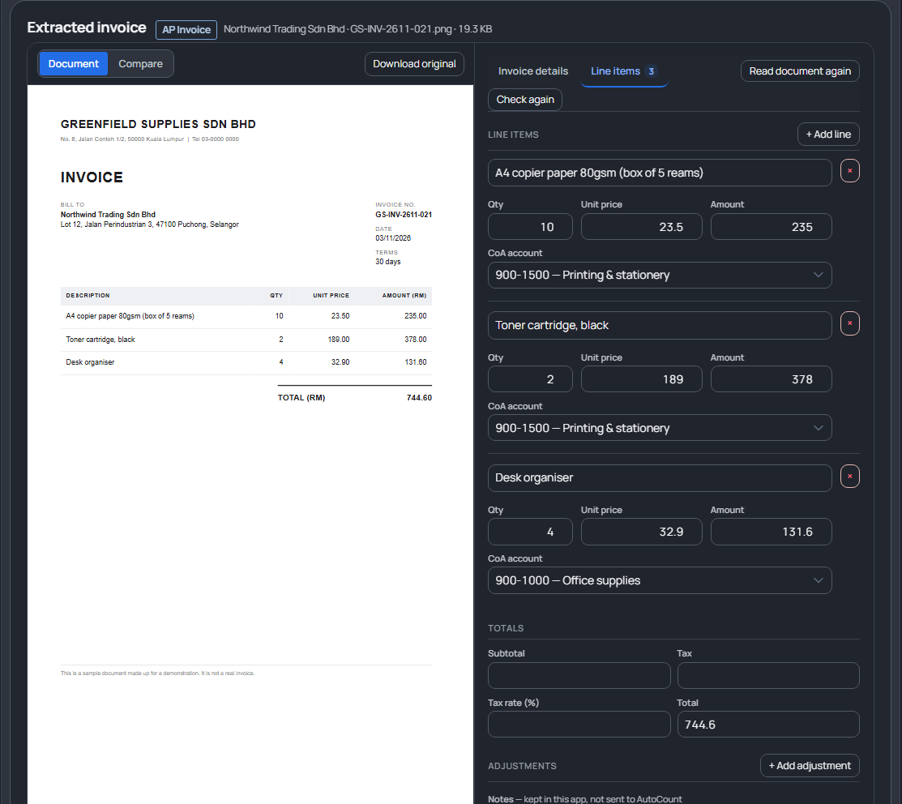

**Upload:** a made-up invoice read and ready to file.

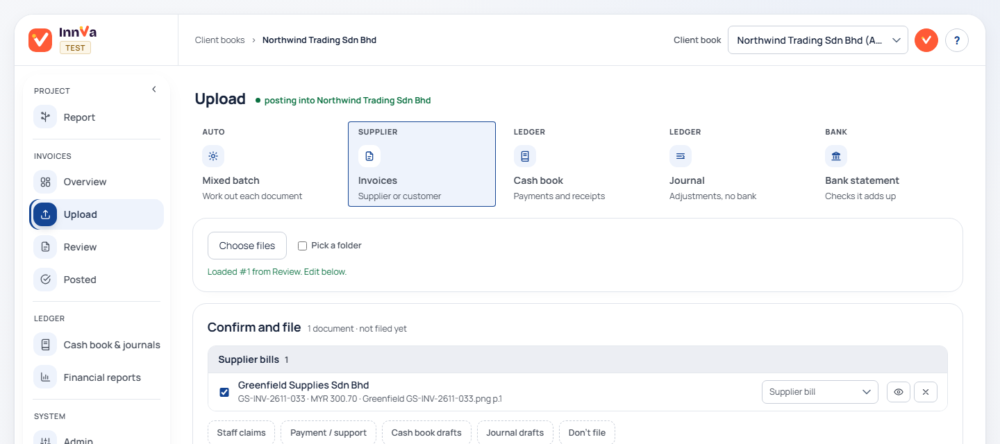

**Posted, and checked against AutoCount:**

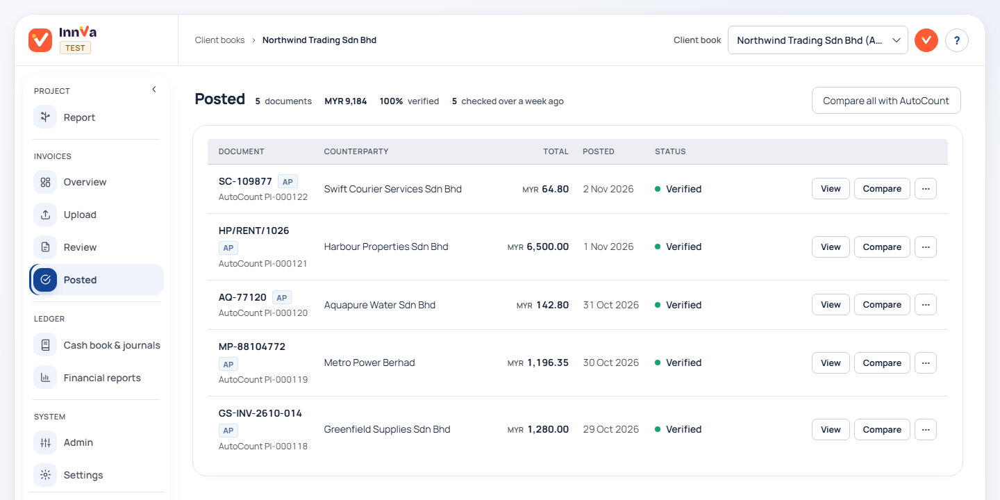

More screens

**Review queue**

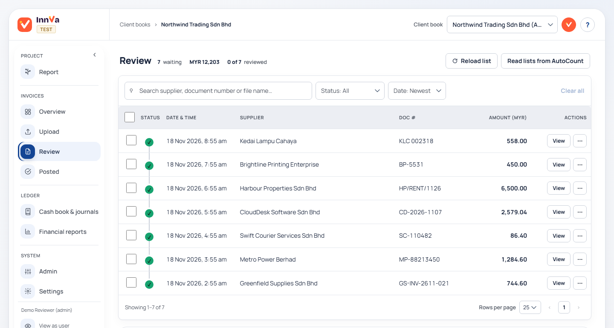

**Overview**

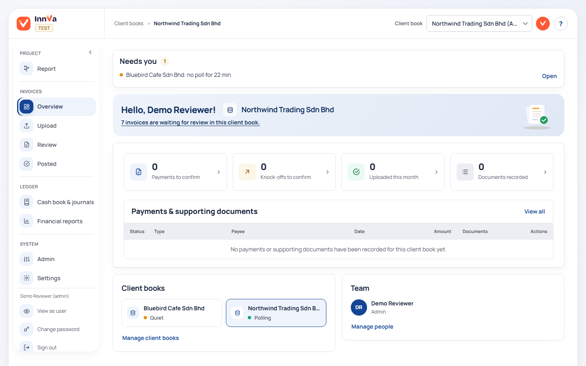

**Review queue, dark mode**

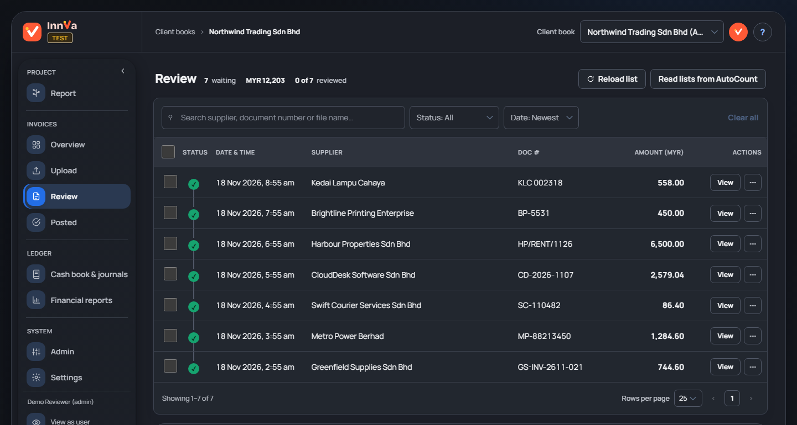

**Invoice details, dark mode**

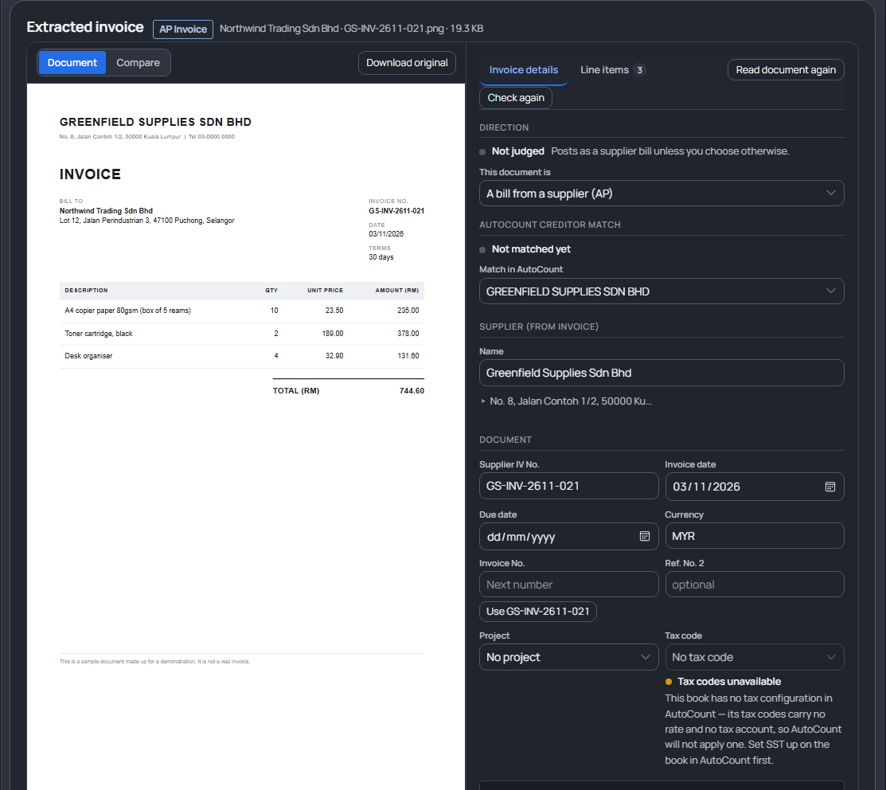

**Line items, light mode**

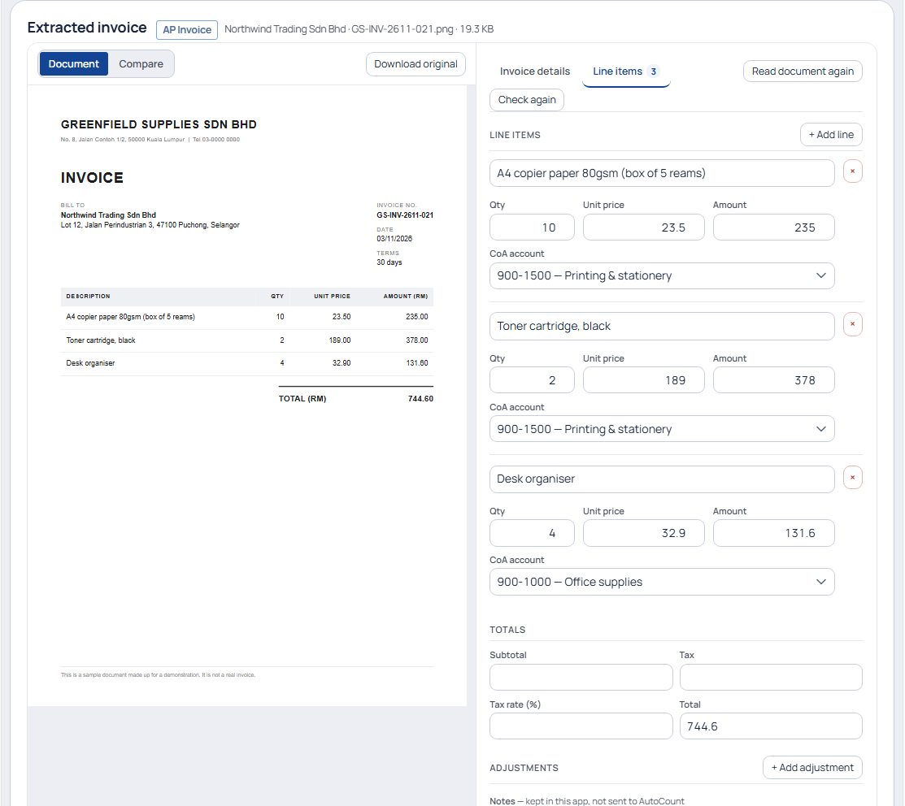

## Tech stack

| Part | Built with |
|---|---|
| Web app | Node.js 24, Express 4, better-sqlite3 (WAL), zod, helmet, express-rate-limit, multer, pdf-lib |
| Page | One HTML page in plain JavaScript, no framework and no build step; light and dark mode, adjustable text size |
| AI | Mistral OCR and Mistral language models for reading; Google Gemini for account coding |
| Bridge | C#, .NET Framework 4.8, AutoCount 2.2 SDK, one Windows service per client book |
| Hosting | Windows VM, WinSW service, Cloudflare Tunnel |
| Sign-in | Microsoft Entra ID (OpenID Connect) and local passwords (bcrypt) |
| Delivery | GitLab merge requests and CI, a Windows runner, automatic rollback |

## By the numbers

| | |
|---|---|
| Built | 14 Sep to 11 Nov 2026 (in production throughout) |
| Commits | 468 on the web app, 186 on the bridge |
| Merge requests | 128 merged |
| Web app | 158 HTTP endpoints, 31 tables, 66 modules, 205 test files |
| Bridge | 35 AutoCount document types behind one API |
| AI cost | about RM 0.10 a document |

## Made by

**Christine Lee**, with **Claude Code** as an AI pair programmer.

The app server can't reach the AutoCount server, so the two halves were built to a written contract: the two sync
endpoints above, plus numbered written replies between the two sides.
