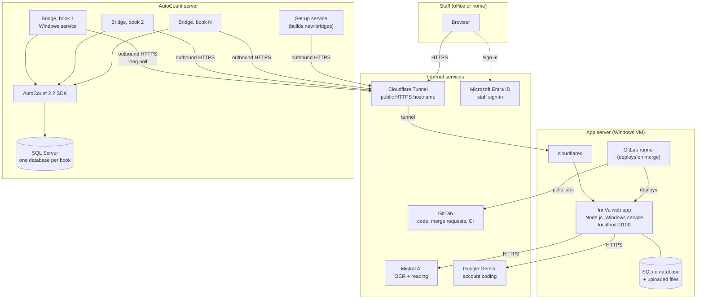
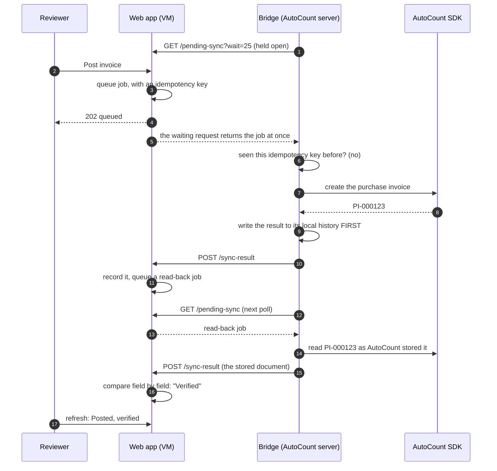
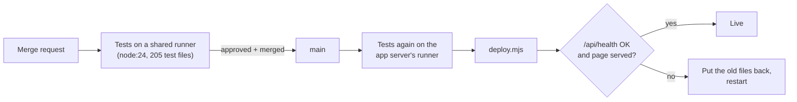

# InnVa architecture

This document describes the whole system: where each part runs, how the parts talk, how a document moves from upload
to AutoCount, and the design choices behind it. For how to use the app, see the [operations guide](GUIDE.md).

## Contents

1. [The constraint that shapes everything](#1-the-constraint-that-shapes-everything)
2. [Where everything runs](#2-where-everything-runs)
3. [How the app server and the AutoCount server talk](#3-how-the-app-server-and-the-autocount-server-talk)
4. [The web app](#4-the-web-app)
5. [The bridge](#5-the-bridge)
6. [A document's journey, end to end](#6-a-documents-journey-end-to-end)
7. [The AI pipeline](#7-the-ai-pipeline)
8. [Coding: rules, history, then AI](#8-coding-rules-history-then-ai)
9. [Staying in step with AutoCount](#9-staying-in-step-with-autocount)
10. [Adding a client book](#10-adding-a-client-book)
11. [Security](#11-security)
12. [Delivery: tests, deploy, rollback](#12-delivery-tests-deploy-rollback)
13. [Design decisions](#13-design-decisions)
14. [Known limits](#14-known-limits)

---

## 1. The constraint that shapes everything

**AutoCount Accounting 2.2 has no web API.** Its programming interface is a set of .NET Framework 4.8 libraries
(`AutoCount.*.dll`) that only work on a machine where AutoCount is installed, opened against that machine's SQL Server.
They can't be called across a network.

So the system has two programs on two machines:

| | Runs on | Written in | Job |
|---|---|---|---|
| **The web app** | the app server (a Windows VM) | Node.js | everything people see: upload, AI reading, review, queue, reports, admin |
| **The bridge** | the AutoCount server | C# (.NET Framework 4.8) | wraps the AutoCount SDK; reads from and writes to the books |

Most of the design follows from that split: posting is a queued job, not a function call; the bridge calls the app,
never the other way round; and every write has to be safe to retry.

## 2. Where everything runs



- **The app server** is a Windows VM. The app runs as a Windows service (wrapped with WinSW) and listens on
  `localhost:3100` only. A Cloudflare Tunnel (`cloudflared`) publishes it on a public HTTPS hostname, so the VM needs
  **no inbound firewall rule** either. Uploaded files and the SQLite database live on the VM's disk.
- **The AutoCount server** runs AutoCount, its SQL Server, and **one bridge per client book**, each a Windows service
  with its own settings file, its own local port and its own key.
- **Outside services:** Mistral (OCR and reading), Google Gemini (account suggestions), Microsoft Entra ID (staff
  sign-in), and GitLab (source, merge requests and CI).

## 3. How the app server and the AutoCount server talk

Only the bridge talks between the two machines, and it only ever makes **outgoing HTTPS calls to the app's public
address**. The app never opens a connection to the AutoCount server, and nothing on the internet can reach it.
It has no inbound firewall rule and no exposed SQL port.

The contract is two endpoints on the app, both authenticated by the bridge's key in an `X-Api-Key` header:

```
GET  /pending-sync?wait=25        "Is there work for my book?"
  -> [ { "id": "123", "idempotencyKey": "<uuid>", "type": "ap-invoice", "payload": { ... } } ]
     (an empty list when there is nothing to do)

POST /sync-result                 "Here is what AutoCount said."
  <- { "id": "123", "success": true, "status": 201, "response": "{\"docNo\":\"PI-000123\"}" }
```



How it behaves:

- **Long poll, so it's fast.** The bridge's request waits on the app for up to 25 seconds. When a reviewer clicks Post,
  the waiting request returns straight away with the job, so the delay a reviewer sees is AutoCount's own posting time,
  not a polling interval. The bridge then loops straight back. If the app can't be reached, it backs off and retries.
- **Batches, one at a time.** The bridge takes up to 5 jobs from one poll and works through them in order, with a
  120-second limit per job. A claimed job that never reports back is marked *stalled* after 30 minutes.
- **One AutoCount session, used by one thread.** The AutoCount session is not thread-safe. The bridge runs every job
  through its own loopback-only HTTP listener (`localhost:8080`, restricted to loopback by Windows' HTTP.SYS), whose
  single-threaded loop makes all AutoCount access run one call at a time.
- **Job types.** `fetch` (any read: chart of accounts, suppliers, tax codes, projects, documents, the change log,
  financial reports), `creditor` (create a supplier), and **any AutoCount document type** for writes:
  `ap-invoice`, `ap-payment`, `ar-invoice`, `journal-entry`, `cash-payment` and so on.
- **Dependent jobs.** A bill from a supplier that AutoCount doesn't know yet queues two jobs: create the creditor,
  then post the invoice. The invoice job is held (`dependsOnJobId`) until the creditor exists, and the real creditor
  code is patched into it before the bridge sees it.

### Why a retry can't post twice

Every job carries an **idempotency key**, generated once when the job is queued and never changed. Before the bridge
runs a write, it looks the key up in its local history file:

- **Already there:** the job ran before. The bridge reports the stored result again and posts nothing.
- **Not there:** it posts, then **writes the result to the history before reporting it**.

That order matters. If the bridge crashes after AutoCount saves the invoice but before the app hears about it, the
evidence is already on disk. When an admin requeues the stalled job (same key), the bridge replays the result instead
of posting a second invoice. Stalled writes are never retried automatically: a person decides. Reads are always safe to repeat.

## 4. The web app

**Stack:** Node.js 24, Express 4, better-sqlite3 (WAL mode), express-session with a SQLite store, zod for validation,
helmet, express-rate-limit, multer for uploads, pdf-lib and adm-zip for splitting PDFs and ZIPs, bcryptjs.
The page is **one HTML file with plain JavaScript**, with no framework and no build step.

| | Size |
|---|---|
| HTTP endpoints | 158 |
| Server | ~12,000 lines in `server.js`, plus 66 focused modules in `lib/` |
| Page | ~21,000 lines (HTML, CSS and JavaScript in one file) |
| Database | 31 tables |
| Tests | 205 test files (`node --test`), run on every merge request |

**Modules, by area** (each is pure where it can be, so it can be tested without a database or network):

| Area | Modules (in `lib/`) |
|---|---|
| Talking to AutoCount | `autocount-bridge` (queue, claim, results, stall), `autocount-payload` (invoice and creditor payloads), `autocount-payment-payload`, `bridge-setup`, `book-identity` |
| Reading documents | `extraction-schema`, `extraction-batch`, `upload-staging`, `upload-check`, `pdf-text`, `ocr-confidence`, `reread-merge`, `same-file`, `fx`, `dates` |
| Matching and coding | `name-match`, `party-match`, `debtor-match`, `project-match`, `tax-code-match`, `coding-memory`, `classify-prompt`, `description-history`, `supplier-number-habit`, `payee-creditor-pick` |
| Checks before posting | `duplicate-check`, `duplicate-outcome`, `line-sum-rule`, `document-note`, `direction` |
| After posting | `autocount-verify`, `verify-outcome`, `verify-sweep`, `cancel-outcome`, `delete-outcome`, `change-log`, `history-fill`, `bill-history` |
| Payments and ledger | `payment-match`, `payment-allocation`, `payment-knockoff`, `payment-method`, `payment-payer`, `outstanding-merge`, `ledger-reconcile`, `gl-document`, `gl-entry`, `claim-journal`, `bank-statement`, `statement-cashbook` |
| Reports | `financial-reports`, `fiscal-calendar`, `project-report`, `git-merges`, `ai-usage` |
| People and access | `sso`, `oidc`, `book-access`, `book-requests`, `admin-tabs`, `mail-alerts` |

**Data** (SQLite, one file, WAL mode). The main groups of tables:

| Group | Tables |
|---|---|
| Documents | `upload_items` (reading in progress), `bills_pending` (waiting for review), `bills_posted` (posted, with what was sent and the read-back result), `supporting_docs`, `bill_support_links`, `gl_entries`, `bank_statements` |
| The queue | `sync_jobs` (with idempotency key, dependency, attempts and the raw result) |
| Copies of AutoCount's lists | `coa_cache`, `supplier_cache`, `debtor_cache`, `tax_code_cache`, `project_cache`, `payment_method_cache`, `fiscal_calendar_cache`, `report_formats_cache` |
| Copies of AutoCount's ledgers | `ap_ledger_cache`, `ar_ledger_cache`, `creditor_outstanding_cache`, `debtor_outstanding_cache`, `bank_doc_cache`, `change_log_state`, `history_fill` |
| Coding memory | `coding_rules`, `payee_creditor_picks` |
| People and books | `app_users`, `sso_allowlist`, `autocount_books`, `book_tax_capability` |
| Records | `audit_log` (who did what, with AutoCount's raw answer), `scheduled_runs` |

The original files stay on the app server. AutoCount gets the document's data and reference number, not the file,
because the bridge has no file-upload route.

## 5. The bridge

**Stack:** C# on .NET Framework 4.8, compiled with Windows' built-in `csc.exe`, running as a Windows service. One
instance per client book, because an AutoCount session is bound to one database when it opens and can't be re-pointed.

What it offers on its loopback listener:

- **A document engine** covering **35 AutoCount document types** through one uniform API: the sales and purchase
  chains, AR and AP documents, journal entries, cash book vouchers and stock transactions. `GET /documents/{type}/fields`
  lists every field AutoCount accepts, found by reflection. **An unknown field rejects the whole document** rather than
  being silently dropped.
- **Writes through AutoCount's own command classes**, so posting, stock costing and credit control behave exactly as
  they do in AutoCount's own screens.
- **Reads:** chart of accounts, creditors, debtors, tax codes, projects, payment methods, outstanding documents,
  fiscal calendar, **AutoCount's own financial reports** (trial balance, profit and loss, balance sheet), and
  **AutoCount's own audit trail** (`/events`, its EventLog table), which the app reads every minute.
- **Cancel and delete** for posted documents.
- **Enrolment:** a new bridge exchanges a single-use enrolment code for its key, so nobody has to paste a key by hand.
- **Idempotency history** (`sync-history.json`, capped at 2,000 entries), as described above.
- **A watchdog** script that restarts an instance that has stopped, and a `/health` route that reports its
  AutoCount connection and sync counters.

## 6. A document's journey, end to end

```mermaid
flowchart LR
  A["Upload<br/>PDF, photo, ZIP"] --> B["Stage + same-file check"]
  B --> C["Read: OCR, then<br/>structure into JSON"]
  C --> D["Confirm and file<br/>(bill, claim, payment,<br/>cash book or journal)"]
  D --> E["Enrich: match supplier,<br/>code lines, duplicate check"]
  E --> F["Review<br/>readiness panel"]
  F -->|Post| G["Queue job<br/>+ idempotency key"]
  G --> H["Bridge posts<br/>in AutoCount"]
  H --> I["Read back +<br/>compare"]
  I --> J["Posted: Verified"]
```



1. **Upload.** Staff drop files (PDFs, photos, ZIPs, or a whole folder) and choose a mode: *Mixed batch* (the app
   works out what each document is), *Invoices*, *Cash book*, *Journal* or *Bank statement*.
2. **Read.** Each file goes through OCR, then a language model turns the text into structured JSON: supplier, dates,
   numbers, currency, line items, totals. One PDF can hold several invoices; the reader finds each one and its pages.
3. **Confirm and file.** The reader proposes what each document is. Staff confirm or change it, then file it.
4. **Enrich.** The supplier is matched against AutoCount's creditor list, each line gets an account
   ([section 8](#8-coding-rules-history-then-ai)), and the duplicate check runs.
5. **Review.** The reviewer sees the document beside what was read, fixes anything, and gets a readiness verdict
   from the server. Post stays disabled until every blocking issue is fixed: lines that don't add up to the total,
   lines with no account, a likely duplicate (unless the reviewer confirms it's genuine), or a credit note that would
   post as an invoice.
6. **Post.** The app builds the AutoCount payload, queues it with its idempotency key, and the bridge posts it.
7. **Verify.** The app queues a read-back of the posted document and compares every header and line field with what
   it sent. Dates are compared as calendar dates, money to 2 decimal places, and text after trimming, so the check
   doesn't raise false alarms. The result is *Verified*, *Differs*, *Not found*, *Renumbered*, *Deleted* or *Cancelled*.

## 7. The AI pipeline

| Step | How |
|---|---|
| OCR | Mistral OCR. Pages come back as markdown with per-word confidence scores, which the review screen uses to point at doubtful values. |
| Text-first | A PDF that already has a text layer skips OCR and goes to a smaller model. That cuts its reading cost by about 80%. |
| Structuring | A Mistral language model in JSON mode at temperature 0. Long documents are read in overlapping page windows and merged by invoice number, so a document that crosses a window boundary is put back together. |
| Validation | Every element is checked against a zod schema. One bad element is rejected on its own and doesn't lose the rest of the file. |
| Supplier match | Normalised names (case, punctuation, "Sdn Bhd" variants), with Jaro-Winkler typo tolerance at 0.9 plus guards that stop near-miss names from matching. |
| Account coding | Rules first, then history, then Gemini with worked examples ([section 8](#8-coding-rules-history-then-ai)). If Gemini fails, the bill is still created and coded by hand. |
| Cost | Every call's tokens and pages are logged per document. The Admin screen shows the cost by client book, by step and by document: about RM 0.10 a document. |

## 8. Coding: rules, history, then AI

Each line's account comes from the first of these that applies, and the screen says which one it was:

1. **A saved rule.** Staff type a sentence such as "delivery charges always go to courier and postage". It's turned
   into a card (phrases plus an account from the book's own chart), which a person confirms. Rules can be scoped to one
   supplier, and they can be switched off.
2. **As last time.** How this supplier's lines were posted from the app before: the closest earlier line by its words,
   or, when every earlier line went to one account, that account.
3. **The AI**, which is shown the rules and the past coding as examples, for lines neither covers.

The reviewer always makes the final call.

## 9. Staying in step with AutoCount

People also key documents straight into AutoCount, and they can edit, renumber or delete what the app posted. To
stay correct:

- **The change log is read every minute.** The bridge's `/events` route returns AutoCount's own audit trail. The app
  uses it to notice new, edited, renumbered, cancelled and deleted documents, without re-reading the whole book.
- **Copies of each book's ledgers** (AP, AR, outstanding documents, bank documents) are kept on the app server and
  refreshed from that log, so duplicate checks and payment knock-offs also cover documents nobody posted through the app.
- **Posted documents are re-checked**, so a posted invoice later changed in AutoCount shows up as *changed after post*.
- **Raw bridge answers are kept for 3 days**, then cleared, so the database doesn't keep growing.

## 10. Adding a client book

1. An admin adds the book in *Admin › Client books* (display name and AutoCount database name).
2. With **automatic set-up** ticked, a set-up service on the AutoCount server, which polls the app every minute,
   claims the book. It receives the book's details and a **single-use enrolment code** (valid 24 hours), builds and
   starts a new bridge instance, and reports progress back. Admin shows each step.
3. The new bridge trades the enrolment code for its permanent key. The app stores only a SHA-256 hash of that key.
4. The app queues the first reads (chart of accounts, suppliers, tax codes and so on), and the book is ready.

## 11. Security

- **No inbound ports** on either server: the app is reached through a Cloudflare Tunnel, and the bridges only call out.
- **Staff sign-in:** Microsoft Entra ID (OpenID Connect) against an allow-list, or a local password (bcrypt, per-IP
  rate limit, per-account lockout). Sessions are HttpOnly, SameSite and Secure, and stored in SQLite.
- **Per-book access:** each person sees only the client books they're given; they can request others, and an admin approves.
- **Bridge and set-up keys** are 32 random bytes, shown once, and stored only as SHA-256 hashes. The bridge endpoints
  sit outside session auth, protected by the key and a rate limiter.
- **CSRF:** every state-changing request must come from the app's own origin.
- **Headers:** helmet with a Content-Security-Policy tuned to the single page.
- **Audit log:** every action is recorded with who did it and AutoCount's raw answer. Admins can "view as user" to
  see exactly what someone else sees.
- **Secrets** (AI service keys, session secret) live in a `.env` file outside git and are never committed.

## 12. Delivery: tests, deploy, rollback



- **Merging is deploying.** Only a protected runner on the app server can run the deploy job, and only for `main`,
  one deploy at a time.
- `deploy.mjs` refuses to run if anyone has edited the live folder by hand. It backs up every file it will change,
  moves the live folder to the merged commit, and restarts the service only when server code changed (the page is
  read from disk). It then checks `/api/health` and that the new page is served. **If either fails, it puts the old
  files back by itself.**
- Tests are fast and isolated: date-sensitive tests run on a faked clock, and HTTP tests boot the app against an
  empty database with made-up books.

## 13. Design decisions

- **Queue instead of call.** Forced by the bridge calling the app. Everything else in section 3 follows from it.
- **Stalled writes are never retried automatically.** An AP invoice can't be un-posted, so a person decides, and the
  idempotency key makes their retry safe.
- **The server gives one verdict.** Whether a document can be posted is decided in one place on the server and shown
  as it is. The page never re-implements the rule, because three copies of one rule once disagreed.
- **Check what AutoCount stored, not what was sent.** A post that returns a document number can still have truncated
  or coerced a value, so every post is read back and compared.
- **Show AutoCount's real error.** Masking errors made problems hard to diagnose; the reviewer sees what AutoCount said.
- **"Queued", not "Done".** Refreshes and posts say they are queued until the bridge answers, so the screen never
  claims something that hasn't happened.
- **Hash keys rather than encrypt them.** The app only needs to verify a key, never show it again.
- **Plain JavaScript, no build step.** One file the server reads per request, so a page change needs no restart and
  can be previewed by swapping one file.

## 14. Known limits

- **Replay protection depends on a local file on the bridge.** If that file is lost, the protection is gone for the
  jobs it held. That is why stalled writes need a person.
- **One bridge build per AutoCount major version.** The SDK changes between versions.
- **No draft state for AP documents in AutoCount.** A post is live at once; the app's own review step is the staging area.
- **Attachments aren't sent to AutoCount.** The original file stays on the app server.
