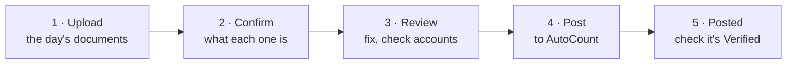
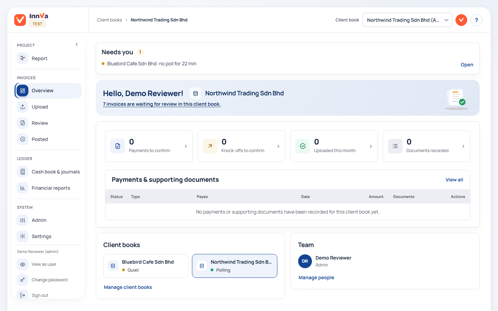
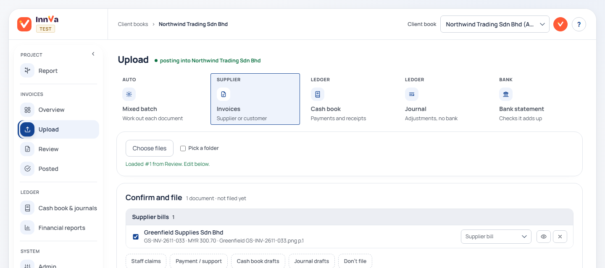
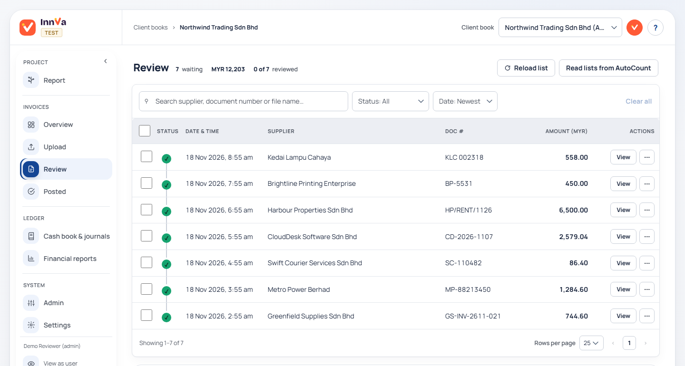
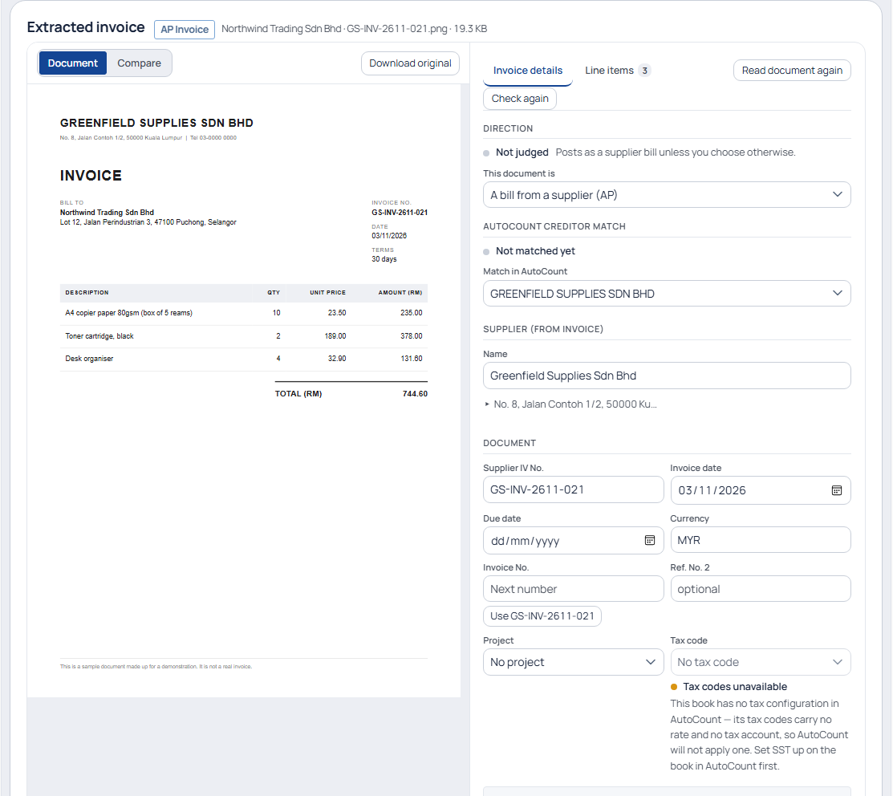
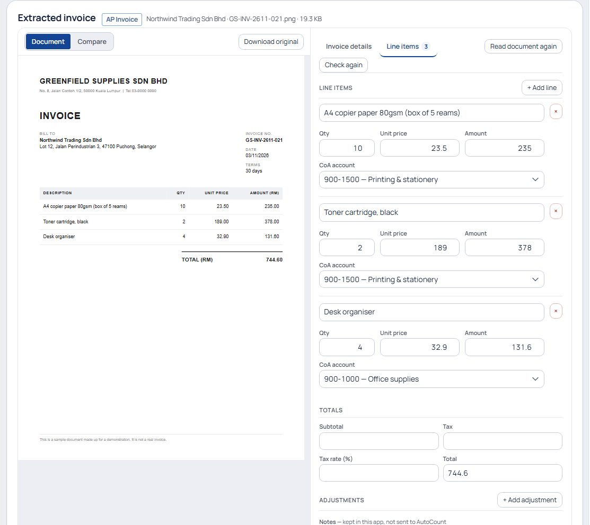
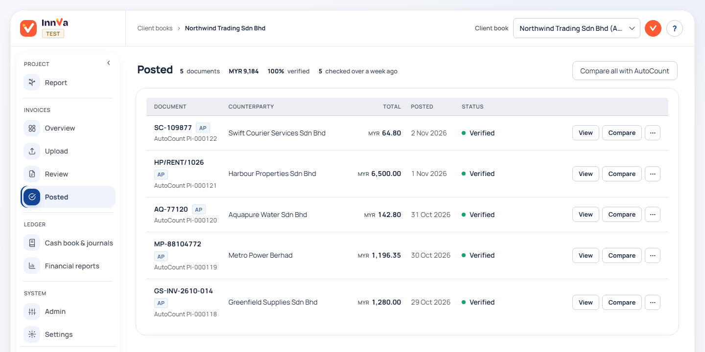

# InnVa operations guide

How the firm uses InnVa day to day, screen by screen. For how it works underneath, see the
[architecture document](ARCHITECTURE.md). Every picture shows made-up companies.

## Contents

1. [Who uses it](#1-who-uses-it)
2. [The daily flow](#2-the-daily-flow)
3. [Overview](#3-overview)
4. [Upload](#4-upload)
5. [Review](#5-review)
6. [Posted](#6-posted)
7. [Payments and supporting documents](#7-payments-and-supporting-documents)
8. [Cash book, journals and bank statements](#8-cash-book-journals-and-bank-statements)
9. [Financial reports](#9-financial-reports)
10. [Settings](#10-settings)
11. [Admin](#11-admin)
12. [When something looks wrong](#12-when-something-looks-wrong)

---

## 1. Who uses it

| Role | What they do |
|---|---|
| **Staff (user)** | Upload documents, review and post them, record payments, for the client books they have access to. |
| **Admin** | Everything staff do, plus people, client books, bridges, the audit log and AI costs. Admins can **view as user** to see exactly what a colleague sees. |
| **Management** | Can be given the *Report* tab, a summary of what has been posted, verified and delivered. |

Everyone signs in with their Microsoft work account, or with a local password. Each person sees only the client
books they have been given. A person can ask for another book, and an admin approves the request.

**Pick the client book first.** The *Client book* selector at the top decides which company everything on screen
belongs to and where posts go. The Upload screen repeats it in green ("posting into …").

## 2. The daily flow

1. **Upload** the documents for one client book.
2. **Confirm and file**: check what the app thinks each document is, then file it.
3. **Review** each bill: compare the document with what was read, check the supplier and each line's account, and fix anything flagged.
4. **Post** when the readiness panel says *Ready to post to AutoCount*. Post one at a time, or tick several and use *Post selected*.
5. **Posted**: each document gets AutoCount's own number (for example PI-000123) and, a few seconds later, the *Verified* mark.

## 3. Overview

The home screen for the chosen client book:

- **Needs you:** anything that needs a person, for example a client book whose bridge has stopped answering.
- **Greeting card:** how many invoices are waiting for review in this book, with a link straight to them.
- **Counters:** payments to confirm, knock-offs to confirm, documents uploaded this month, documents recorded.
- **Payments and supporting documents:** the latest payment slips and supporting files ([section 7](#7-payments-and-supporting-documents)).
- **Client books:** every book you can open, with its bridge status (*Polling* means AutoCount is connected).
- **Team** and **Waiting, by age:** who has access, and how long documents have been waiting.

## 4. Upload

1. **Choose a mode:**

   | Mode | Use it for |
   |---|---|
   | **Mixed batch** | A pile of different documents. The app works out each one: supplier bill, staff claim, payment slip, cash book entry or journal. |
   | **Invoices** | Supplier bills (purchases) or customer invoices (sales). |
   | **Cash book** | Payments and receipts, read into cash book drafts. |
   | **Journal** | Adjustments with no bank movement, read into journal drafts. |
   | **Bank statement** | A bank statement. The app checks that the running balance adds up. |

2. **Choose files** (PDF, JPG, PNG or ZIP), or tick *Pick a folder*. A PDF can contain many invoices: the app finds each one and its pages.
3. Click **Read N files.** Each file is read by AI. Files already uploaded before are flagged, so the same document isn't filed twice.
4. **Confirm and file.** Documents are grouped by what they are (*Supplier bills*, *Staff claims*, *Payment / support*, *Cash book drafts*, *Journal drafts*). For each one you can:
   - change what it is with the drop-down (for example from *Supplier bill* to *Staff claim*), which reads it again for that purpose;
   - preview the page with the eye button, or remove it with ×;
   - move a whole document to *Don't file*.
5. Click **File N.** Supplier bills go to **Review**; drafts go to **Cash book & journals**.

Documents read but not filed are kept for 14 days, then cleared.

**A whole month in one ZIP.** In *Mixed batch*, a ZIP of invoices, payment vouchers and bank slips is opened and each
document is read on its own. Supplier bills, customer (sales) invoices and payments land in their own lanes, ready
to file together. A bank *statement* is different: it has its own mode and is uploaded one file at a time, because
the app checks its running balance line by line.

## 5. Review

**The queue** lists every bill waiting in this client book, newest first, with its supplier, document number and
amount. The header shows how many are waiting, their total, and how many have been reviewed.

- **Search** by supplier, document number or file name. **Filter** by status and **sort** by date.
- A green tick means the bill has no blocking issue. *Reviewed by you* (or by a colleague) shows who has already checked it.
- **Read lists from AutoCount** refreshes this book's chart of accounts, suppliers, tax codes and projects.
- Tick several bills and use **Post selected** to post them together. You'll be asked to confirm, and anything not ready is skipped with the reason.

**Opening a bill** shows the document on the left and what was read on the right.

- **Document / Compare:** the original file, or a side-by-side comparison. **Download original** saves the file as uploaded.
- **Invoice details tab:**
  - *Direction:* a bill from a supplier (AP) or an invoice to a customer (AR).
  - *AutoCount creditor match:* the supplier in AutoCount this bill belongs to, with how it was matched. Pick another if it's wrong. A new supplier can be created when the bill is posted.
  - *Supplier (from invoice):* the name and address as printed.
  - *Document:* AutoCount's own labels: **Supplier IV No.** (the supplier's invoice number), invoice date, due date, currency, **Invoice No.** (AutoCount's running number, or use the supplier's), Ref. No. 2, project and tax code.
- **Line items tab:** each line's description, quantity, unit price, amount and **CoA account**. The account shows where it came from: a saved rule, *as last time* (this supplier's history), or the AI. Add lines, remove lines, and add adjustments (deposit, discount, rounding). The totals must add up.

- **Notes** are kept in InnVa only. They are not sent to AutoCount.
- **Read document again** re-runs the AI reading; **Check again** re-runs the supplier match, coding and duplicate check.
- **The readiness panel** at the bottom gives the server's verdict:
  - *Ready to post to AutoCount*, or
  - *Not ready: N issues to fix*, with each issue listed. Typical issues: lines that don't add up to the total, lines with no account, a likely duplicate of something already in AutoCount, or a credit note that would post as an invoice.

  **Post to AutoCount** stays disabled until the panel is clear. A likely duplicate can be confirmed as genuine, for
  example two real invoices from one supplier on the same day.
- **Post to AutoCount** queues the post. The bill shows *Posting…* while AutoCount works (usually a few seconds), then moves to **Posted**.

## 6. Posted

Every document posted from InnVa in this client book: its own number, AutoCount's number, the counterparty, the total and the posting date.

- **Status** comes from reading the document back out of AutoCount:

  | Status | Meaning |
  |---|---|
  | **Verified** | Every field AutoCount stored matches what was sent. |
  | **Pending** | The read-back hasn't come back yet (seconds). |
  | **Differs** | AutoCount holds something different. **Compare** shows which field. |
  | **Changed after post** | Someone edited it in AutoCount afterwards. |
  | **Renumbered / Deleted / Cancelled** | It was renumbered, deleted or cancelled in AutoCount. |
  | **Not found** | AutoCount no longer has it. |

- **View** opens the original file. **Compare** shows what was sent beside what AutoCount stored.
- **Compare all with AutoCount** re-checks every posted document in the book.
- The **⋯** menu can **cancel** or **delete** a document in AutoCount. The result is confirmed by reading AutoCount
  again, never assumed.

## 7. Payments and supporting documents

Payment vouchers, bank slips, receipts and other supporting files appear in this list, under the Review queue and on
the Overview. They arrive either from a *Mixed batch* upload, which sorts them out of a pile or a ZIP by itself, or
from the *Payment / support* choice.

Open a payment by clicking its row:

1. **Which way the money went.** *Money out* (the book paid a supplier) or *Money in* (a customer paid the book). This
   is decided from who issued the document and who received the money. If it says *Direction not established*,
   use **Read lists from AutoCount** so the app knows the book's own company details.
2. **Which invoices it pays.** The payee is matched to the creditor (or the customer to the debtor). Their open
   invoices are listed, and the ones the payment settles are ticked for you, using the amount and the invoice
   numbers printed on the payment (*refs*). **Request open items** adds invoices from AutoCount itself, including
   ones keyed directly into AutoCount.
3. **Check the split:** *Knock off* (the amount applied) and *Unapplied* (any remainder). Change the ticks if needed,
   then click **Confirm knock-off**.
4. **Paid by:** choose the bank or cash account (AutoCount's payment methods).
5. **Post payment to AutoCount** and confirm. AutoCount records the payment and knocks it off the invoices. The app
   reads the payment back to check it.

The app refuses to settle an invoice that AutoCount hasn't confirmed is still open, so a payment can't settle an
invoice that was already paid or cancelled. A supporting document that isn't a payment (a delivery order or a
statement) is kept as evidence beside the bill it supports.

## 8. Cash book, journals and bank statements

- **Not yet in AutoCount:** cash book and journal drafts read from documents. Each draft shows its lines. Check the
  accounts and the bank, then post it. Nothing here is posted without a person.
- **Bank statements:** an uploaded statement is checked line by line so the running balance adds up. Its rows can
  become cash book drafts, with accounts suggested from saved rules and history.

## 9. Financial reports

AutoCount's own **trial balance**, **profit and loss** and **balance sheet** for the chosen client book and period,
read live from AutoCount through the bridge, so the figures are AutoCount's, not a re-calculation.

## 10. Settings

- **Appearance:** light or dark mode, a colour theme, a font, and **text size**, for people who prefer bigger text
  without using browser zoom.
- **Knowledge cards (Ask InnVa):** coding rules in plain words. Type a sentence such as *"delivery charges always go
  to courier and postage"*. InnVa turns it into a card (the phrases to look for and the account from this book's
  chart). Once you confirm the card, it codes matching lines in every new document, and in waiting bills nobody has
  coded yet. Cards can be limited to one supplier, switched off or removed, and the audit log records who changed them.

## 11. Admin

| Section | What it's for |
|---|---|
| **People** | Create users, set roles (admin or user), give access to client books, disable an account. |
| **Allowed Microsoft sign-ins** | Which Microsoft work accounts can sign in. |
| **Client books** | Add a book (display name and AutoCount database name), see each book's bridge status and when it was last seen, and replace a bridge key. Book requests from staff are approved here. |
| **Automatic bridge set-up** | Register the set-up service on the AutoCount server once. After that, adding a book with *Set up its bridge automatically* ticked builds that book's bridge with no manual steps, and each step shows here. |
| **Audit log** | Every action: who, when, what changed, and AutoCount's raw answer. |
| **Measured results** | How long reviews take and how often bills are revisited. |
| **AI reading costs** | What the AI reading costs, by client book, by step, and the most expensive documents. |
| **Email alerts** | Alerts for problems that need a person (built, switched off by default). |

**Stalled posts.** A post whose answer never came back from AutoCount is marked *stalled* on the bill. Admins see a
**Requeue this job** button there. Requeuing keeps the job's original key, so the bridge replays the first result
instead of posting a second invoice.

## 12. When something looks wrong

| What you see | Likely cause | What to do |
|---|---|---|
| A post stays at *Queued* or *Posting…* | The book's bridge is stopped, or can't reach the app. | Check the book's status on the Overview (*Polling* or not) and its last-seen time in Admin. Restart the bridge's service on the AutoCount server. |
| *Tax codes unavailable* or *No projects read* | This book's lists haven't been read from AutoCount yet. | Click **Read lists from AutoCount** on the Review screen. |
| The supplier isn't matched | A new supplier, or a name very different from AutoCount's. | Pick the right creditor in *AutoCount creditor match*, or post and let it be created. |
| *Lines still need a CoA account* | No rule, no history, and no AI suggestion for those lines. | Pick the accounts. Add a knowledge card if it will happen again. |
| A post is refused as a duplicate | AutoCount already holds this supplier's invoice. | Check it isn't the same invoice twice. If it's genuine, confirm it and post again. |
| A payment says *Direction not established*, or a sales invoice is read as a supplier bill | The app hasn't read this book's own company details yet. | Click **Read lists from AutoCount**, then **Check again**. |
| A payment won't post: "AutoCount has not confirmed … is still open" | The invoice's open balance hasn't been read from AutoCount. | Click **Request open items** on the payment, then tick the invoice again. |
| *Differs* on Posted | AutoCount stored a value differently, for example a description cut at its length limit. | Open **Compare** to see the field, then fix it in AutoCount if needed. |
| A post is *stalled* | The bridge took the job but its answer never arrived. | An admin clicks **Requeue this job** on the bill. It is safe: the bridge replays, it does not post twice. |
